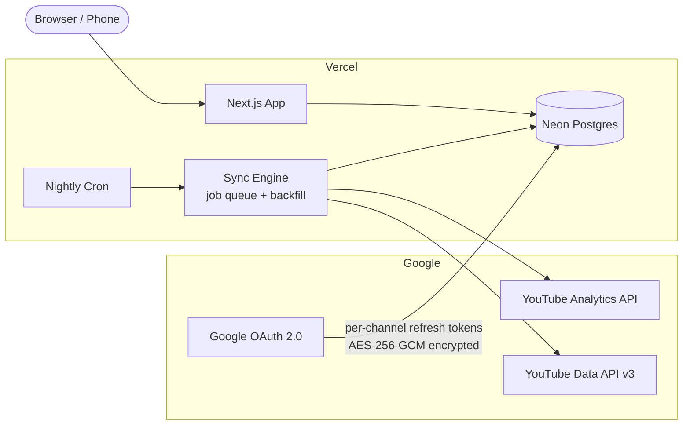

# ChannelDeck

**All your YouTube channels. One dashboard.**

ChannelDeck is a self-hosted analytics platform for creators who run multiple YouTube channels. Instead of toggling between channels in YouTube Studio, connect every channel once and get Studio-grade analytics — views, watch time, subscribers, traffic sources, audience demographics, and estimated revenue — combined across your whole portfolio and per channel.

Built on the official YouTube Analytics & Data APIs. Your data syncs nightly into your own Postgres database; nothing is shared with any third-party service. Runs entirely on free tiers (Vercel + Neon).

---

## Features

### Portfolio overview
- Combined KPI cards — views, watch hours, net subscribers, estimated revenue — with period-over-period deltas
- Aggregated views and revenue charts across all channels
- Channel comparison table with per-channel sparklines and lifetime subscriber counts
- Data-freshness badge (YouTube finalizes revenue with a 2–3 day lag)

### Per-channel drill-down
- KPI cards with deltas and RPM
- Tabbed time-series charts: views, watch time, net subscribers, revenue
- Top videos for the selected range, with per-video watch time and revenue
- Traffic source breakdown, age/gender demographics, top countries

### Platform
- Date-range presets (7 / 28 / 90 / 365 days) on every page, kept in the URL
- Mobile-responsive — check your channels from your phone
- Single-owner authentication: Google sign-in locked to one allowlisted email
- One-click channel connect via Google OAuth, including Brand Account channels
- Nightly automated sync with a 365-day historical backfill on first connect
- Per-channel fault isolation: one expired token never blocks other channels

## Architecture



- **Sync engine** ([src/lib/sync/engine.ts](src/lib/sync/engine.ts)) — a Postgres-backed job queue. New channels enqueue 90-day backfill chunks covering the last year; the nightly cron re-pulls the trailing 5 days per channel so YouTube's late revenue adjustments self-correct. All writes are idempotent upserts. Long queues self-chain new serverless invocations to stay under function time limits.
- **Channel connect** ([src/app/api/channels/](src/app/api/channels/)) — one OAuth grant per channel (`prompt=consent select_account` surfaces Google's account chooser for Brand Accounts). Refresh tokens are encrypted at rest with AES-256-GCM.
- **Dashboard** — React Server Components query Postgres directly; browsing never spends API quota.

## Tech stack

| Layer | Technology |
|---|---|
| Framework | Next.js 16 (App Router, TypeScript) |
| Database | Neon Postgres + Drizzle ORM |
| Auth | Auth.js v5 (Google provider, JWT sessions, email allowlist) |
| UI | Tailwind CSS v4, shadcn/ui, Recharts |
| Hosting & scheduling | Vercel + Vercel Cron |
| Data sources | YouTube Analytics API, YouTube Data API v3 |

## Getting started

Full click-by-click instructions (Google Cloud project, OAuth consent screen, Neon, Vercel): **[SETUP.md](./SETUP.md)**.

The short version:

```bash
git clone <this repo> && cd youtube-dashboard
npm install
cp .env.example .env       # fill in (see table below)
npx drizzle-kit migrate    # create tables
npm run dev                # http://localhost:3000
```

Then sign in, go to **Settings → Add channel**, and authorize each channel once.

### Environment variables

| Variable | Purpose |
|---|---|
| `DATABASE_URL` | Neon Postgres connection string (pooled) |
| `AUTH_SECRET` | Auth.js session signing secret |
| `GOOGLE_CLIENT_ID` / `GOOGLE_CLIENT_SECRET` | OAuth client (dashboard login + channel connect) |
| `ALLOWED_EMAIL` | The only Google account allowed to sign in |
| `TOKEN_ENCRYPTION_KEY` | 32-byte hex key for refresh-token encryption |
| `CRON_SECRET` | Bearer token protecting the sync endpoint |
| `NEXT_PUBLIC_APP_URL` | Base URL for OAuth redirects |
| `REVENUE_CURRENCY` | Optional display currency (default `USD`) |

> ⚠️ The Google OAuth consent screen must be **External and published to Production**. In Testing status, Google revokes refresh tokens every 7 days and the sync dies silently. Read-only YouTube scopes do not require verification review. Details in [SETUP.md](./SETUP.md).

## Commands

```bash
npm run dev                # local dev server
npm run build              # production build
npx drizzle-kit migrate    # apply DB migrations
npx drizzle-kit generate   # regenerate migrations after schema changes
```

## Project structure

```
src/
  db/schema.ts                  # channels, daily metrics, snapshots, sync queue
  lib/google/oauth.ts           # channel OAuth: auth URL, code exchange, refresh
  lib/google/youtube.ts         # typed Data API + Analytics API client
  lib/sync/engine.ts            # job queue, backfill chunks, nightly sync
  lib/queries.ts                # dashboard aggregation queries
  app/(dashboard)/page.tsx      # portfolio overview
  app/(dashboard)/channels/[channelId]/   # per-channel drill-down
  app/(dashboard)/settings/     # connect/remove channels, sync history
  app/api/cron/sync/            # cron target (Bearer CRON_SECRET)
  proxy.ts                      # route protection
```

## Data notes

- **Revenue** is YouTube's *estimated* revenue and is subject to month-end adjustment; the trailing-5-day re-sync keeps recent figures converging to final values.
- **Impressions / CTR**: Google added thumbnail-impression metrics to its bulk Reporting API in January 2026; availability in the targeted Analytics API varies. ChannelDeck requests them opportunistically and shows “—” where unavailable.
- **Timezone**: YouTube Analytics days are America/Los_Angeles; the nightly sync runs at 09:00 UTC, after the Pacific analytics day closes.

## Roadmap

- [ ] Multi-channel metric overlay (`/compare`)
- [ ] Cross-channel recent uploads feed with early performance
- [ ] Weekly email digest & milestone alerts
- [ ] CSV export
- [ ] Anomaly detection (day > 2σ from 28-day mean)

---

Private project — not licensed for redistribution.
